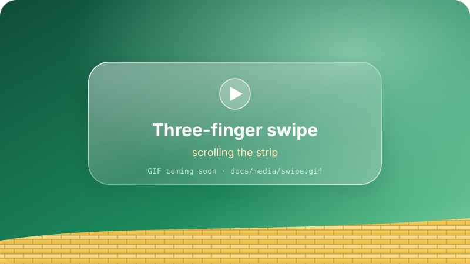
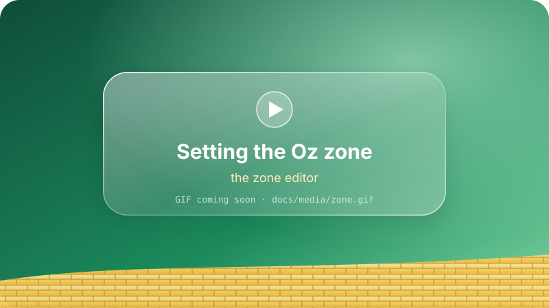
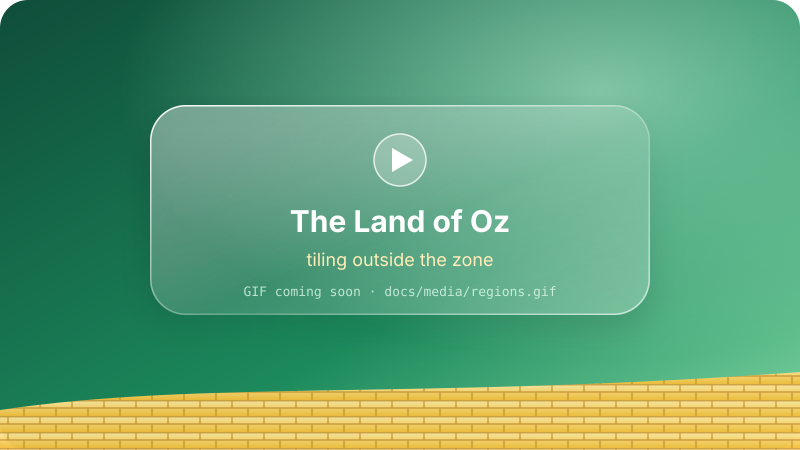

<p align="center">
  
</p>

<p align="center">
  
  
  
  
</p>

<p align="center"><b><i>There's no place like a tidy desktop.</i></b></p>

**Oz** is a **vertically scrolling** tiling window manager for macOS, inspired by [PaperWM](https://github.com/paperwm/PaperWM).

Instead of squeezing every window onto the screen, Oz lays them one after another along an endless **vertical strip** — your own yellow brick road, one brick (window) at a time. The screen is a window onto that road: **swipe up and down with three fingers** to walk along it. Let go and it glides on, settling on a window edge when it ends near one.

```
┌──────────── screen ───────────┐
│ ┌───────────────────────────┐ │
│ │        Terminal           │ │ ← focused
│ └───────────────────────────┘ │
│ ┌────────────┐ ┌────────────┐ │
│ │   Safari   │ │   Notes    │ │ ← two panels in one row
│ └────────────┘ └────────────┘ │
└───────────────────────────────┘
  ┌───────────────────────────┐
  │          Xcode            │   ← further down the road: three fingers up brings it in
  └───────────────────────────┘
  ┌───────────────────────────┐
  │          Mail             │
  └───────────────────────────┘
```

<p align="center"></p>

### 🗺️ A map of Oz

- [🟡 Follow the Yellow Brick Road](#-follow-the-yellow-brick-road) — install and first launch
- [👣 Walking the road](#-walking-the-road) — the strip, rows, widths, gestures
- [💚 The Emerald City](#-the-emerald-city) — the Oz zone and the land around it
- [👠 The Ruby Slippers](#-the-ruby-slippers) — shortcuts
- [🔮 The Wizard's control room](#-the-wizards-control-room) — settings
- [📜 The Wizard's spellbook](#-the-wizards-spellbook) — `config.js`
- [🎭 Pay no attention to the man behind the curtain](#-pay-no-attention-to-the-man-behind-the-curtain) — how it works
- [🦁 Lions and tigers and bears](#-lions-and-tigers-and-bears) — known limitations

<p align="center"></p>

## 🟡 Follow the Yellow Brick Road

You'll need macOS 14+ and Xcode / Swift 5.9+. Then, brick by brick:

```bash
make run        # builds build/Oz.app and starts it
make install    # copies it to ~/Applications/Oz.app and starts it
make test       # unit tests
make stop       # quits the running Oz
```

**🧱 Brick one — Accessibility.** System Settings › Privacy & Security › Accessibility › turn on *Oz*. Oz starts the moment it's allowed.

**🧱 Brick two — the trackpad.** If the three-finger vertical swipe still belongs to Mission Control, Oz asks to borrow it. With *Apply*:

- three fingers up/down → **Oz walks the strip**
- **three-finger double tap → Mission Control** (toggles it, like the Mission Control key)
- Mission Control also stays on four fingers up and F3; App Exposé on four fingers down
- to give it back: menu bar › *Trackpad: Restore macOS Gestures* (or `scripts/trackpad-gestures.sh restore`)

If it doesn't take effect right away, set System Settings › Trackpad › More Gestures › Mission Control to **"Swipe Up with Four Fingers"** (same thing).

**🧱 Brick three — Screen Recording** (optional). Lets windows slide off the top edge (see [behind the curtain](#-pay-no-attention-to-the-man-behind-the-curtain)). Without it Oz shrinks them instead.

> **🔧 Developer's note:** with an ad-hoc signature every build changes the code signature and macOS forgets the Accessibility permission. Run `./scripts/create-signing-cert.sh` once: it adds a self-signed "Oz Local Signing" identity to your login keychain, `make app` uses it automatically, and the permissions survive rebuilds (`SIGN_ID=...` for another identity).

The ▤ menu bar icon is your hot-air balloon: toggle tiling (everywhere or just this desktop), live capture, smooth scrolling, the Emerald City's size, Settings, retile, edit/reload the config, open the log, trackpad setup, quit. When Oz quits, it brings every window it hid back on screen — nobody gets left in Oz.

<p align="center"></p>

## 👣 Walking the road

### Gestures

| Gesture | Action |
|---|---|
| Three fingers up/down | Walk the strip freely; on release it glides with your speed and settles on a window edge (top or bottom) when it ends near one. Focus doesn't change (`swipe.focus: true` to focus the top window). `snap: "always"` for panel-by-panel scrolling. |
| Three-finger double tap | Mission Control (configurable) |
| Three fingers left/right | Left to macOS (switching Spaces) |

If the road runs the wrong way, set `swipe.natural: false`. While it moves, a thin bar along the zone's right edge shows how much of the road is in view and where you are on it; it fades a moment after you stop.

When Oz opens Mission Control or App Exposé (double tap, `⌃⌥ m`, `⌃⌥⇧ m`) it first brings the windows waiting further down the road onto the screen, so the overview shows them at a normal size, and walks them back when it closes. Opened another way (four-finger swipe, the Mission Control key) the overview sees them where they wait and draws them small.

<p align="center"></p>

### Rows and widths

- **Narrow a window with the mouse.** Alone in its row, the space beside it stays empty and the window stays where you left it: narrowed from the right it keeps its left edge, from the left its right edge, so you can place it anywhere in the row by its edges — or drag it by its title bar and drop it in the same row: it slides back in at the sideways place you dropped it. Keyboard width changes keep its place too (moving it left only as far as it needs to fit); back at full width it fills the row again.
- **Side by side:** drag a window beside another (the vertical split line, below) or use `joinUp` / `joinDown` / `slurpIn`. Rows are never merged on their own.
- **Moving up/down** (`⌃⌥⇧ ↑/↓`): if the next row holds a single narrowed window and this one fits beside it, it joins that row (on the side it's on) and the two share it; press again and it carries on, into a row of its own beyond. Otherwise the rows swap.
- From the keyboard, in a single-window row: `cycleWidth` (`⌃⌥ w`) cycles 1/3 → 1/2 → 2/3 → full, `resizeWidth` (`⌃⌥ , / .`) narrows/widens in steps, `equalizeRow` (`⌃⌥ =`) goes back to full width.
- While you resize a window, its neighbours make room live.
- Keyboard moves (moves, joins, width/height changes, floating) slide the windows to their new places over `animationDuration` instead of jumping — rows slide in and out of view too.

### Click your heels three times

- **Double click a title bar** (macOS zoom): the window fills the whole usable screen — over the Emerald City and the land around it — while the rest of the strip waits behind it. Double click again and it slides back into its place. Same as `toggleMaximize` (`⌃⌥⇧ f`). Rearranging the strip puts it back first.
- **Undo** (`⌃⌥ z`): puts the strip back as it was before its last change — keyboard moves and sizes, drags and drops, mouse resizes, a window dragged out of the zone (it comes home) — up to 20 steps, sliding the windows back.
- **Saved across restarts.** Each desktop's arrangement (rows, heights, widths, places in a row, scroll position, focus, and the windows docked around the zone) is written to `~/Library/Application Support/Oz/layout.json` whenever it changes and when Oz quits, and put back when Oz starts. Windows are recognised by their id (the same while their app keeps running) or, after the app restarted, by app and title; ones it doesn't know are added after them.

<p align="center"></p>

### Tiling per desktop

Each Mission Control desktop can be tiled or left to roam free: `⌃⌥⇧ esc` (`toggleSpaceTiling`) or menu bar › *Tile This Desktop*. On a free desktop Oz leaves every window where it is (hidden ones come back on screen) and ignores its gestures and shortcuts; tiling it again picks its windows up. The choice is remembered across restarts. A window moved to a free desktop is let go.

<p align="center"></p>

## 💚 The Emerald City

By default the road runs across the whole screen. But you can give it a city of its own — the **Oz zone** — and leave the rest of the screen to the land of Oz around it.

Menu bar › *Set Scroll Area…* (or `⌃⌥⇧ a`): the windows hide behind the wallpaper, the rest of the screen dims, and the hatched area can be resized by its edges and corners, moved by dragging inside it, or drawn anew (presets: left/right half, left/right two thirds, full). Return saves, Esc cancels. The strip then lives in the zone only: windows are cut off at its top and bottom edges the same way they slide off the top of the screen. Each desktop has its own city, remembered across restarts; *Reset Scroll Area* gives it the whole screen again.

<p align="center"></p>

### Split lines in the city

Drag a window over the zone and a glowing line shows exactly where it will go:

- a **horizontal line** between two rows — above the row under the cursor when it's in the row's upper half, below it otherwise;
- a **vertical line** beside a window when the cursor is near its left or right edge — then they share the row.

Let go and it slides into that slot. This works for windows already in the strip too, so you can rearrange the road by dragging. No line means it would stay where it is. To reach rows out of view, rest the cursor in the band along the zone's top or bottom edge (15% of its height): after a moment the road scrolls that way, faster the closer you are to the edge. It only arms once the drag has been in the middle of the zone, so grabbing a title bar at the top doesn't send you flying.

<p align="center"></p>

### The land of Oz around it

With a zone set, the rest of the screen is free for windows that stay put:

- **Drag a window out** of the zone (by its title bar): it leaves the strip and stays where you dropped it, untouched by scrolling. The strip closes the gap.
- **Tear a tab off** (Chrome, Safari, Finder, Terminal…) and drop it outside the zone: the new window stays there. Dropped inside, it joins the strip.
- **Regions.** The land around the city is divided into rectangles — one per side of the zone wide enough for a window (150 pt), as few as possible, the corners going to whichever side makes the longest one. A window dropped outside the zone is tiled in the region under the cursor: alone it fills it; if a window is already there, the region is split in half along its long side (stacked in a tall region, side by side in a wide one) and the new window takes the half where the cursor is. When one leaves, the rest close the gap; when the city is resized, they move to the region that now holds them.
- **Coming home.** Drag a window back into the zone and it joins the strip where the split line shows. The same goes for a window floated with `toggleFloat`; windows that float because of a rule or a fixed size stay floating.

<p align="center"></p>
<p align="center"></p>

### 🫧 Glinda's bubble

While you drag, a pane of **Liquid Glass** (frosted glass before macOS 26) floats in to show where the window will land: its slot in a region, or the city itself when it would join the strip. It stays out of the way while a tiled window is still inside the zone (it just goes back home) or while you resize by an edge.

<p align="center"></p>

## 👠 The Ruby Slippers

`⌃⌥` = ctrl+alt, `⇧` = shift. Keys are resolved in the active keyboard layout; the defaults are for a US layout (edit the `K` table at the top of the config for others, e.g. Turkish Q uses `ğ ü ö ç - .`).

| Keys | Action | | Keys | Action |
|---|---|---|---|---|
| `⌃⌥ h j k l` / arrows | focus left/down/up/right | | `⌃⌥⇧ h j k l` / arrows | move the window |
| `⌃⌥ 1…9` | go to row n | | `⌃⌥ home/end` | first/last row |
| `⌃⌥ [` | **joinUp**: into the row above, side by side | | `⌃⌥ ]` | **joinDown**: into the row below |
| `⌃⌥ i` | slurpIn: pull the window below into this row | | `⌃⌥ o` | barfOut: take it out of the row |
| `⌃⌥ w` / `⌃⌥⇧ w` | width share 1/3 → 1/2 → 2/3 | | `⌃⌥ =` | equalize the row |
| `⌃⌥ ,` / `⌃⌥ .` | narrower / wider | | `⌃⌥⇧ ,` / `⌃⌥⇧ .` | shorter / taller |
| `⌃⌥ s` | side by side: pull in + equalize | | `⌃⌥⇧ s` | this panel 2/3 |
| `⌃⌥ r` / `⌃⌥⇧ r` | cycle height | | `⌃⌥ f` | toggle full height |
| `⌃⌥⇧ f` | fill the screen / back into the strip | | `⌃⌥ z` | undo the last layout change |
| `⌃⌥ c` / `⌃⌥ t` | center / align to top | | `⌃⌥ u` / `⌃⌥ d` | scroll half a screen |
| `⌃⌥⇧ pageup/pagedown` | start / end of the strip | | `⌃⌥ esc` | toggle floating |
| `⌃⌥ return` | new Terminal | | `⌃⌥⇧ q` | close the window |
| `⌃⌥ n` | move to the next screen | | `⌃⌥ m` / `⌃⌥⇧ m` | Mission Control / App Exposé |
| `⌃⌥⇧ t` | toggle tiling | | `⌃⌥⇧ esc` | toggle tiling for this desktop |
| `⌃⌥⇧ c` | reload the config | | `⌃⌥⇧ a` | set this desktop's Oz zone |
| `⌃⌥ /` | shortcut cheat sheet | | | |

<p align="center"></p>

## 🔮 The Wizard's control room

Menu bar › *Settings…* (⌘,) has the everyday levers: gaps, row width, new window height and position, animation length, swipe sensitivity and direction, how a swipe comes to rest and glides, smooth scrolling, how windows at an edge are drawn and the live capture rate, and the three-finger double tap. Changes apply at once and are kept apart from the config file, on top of it (the file stays as you wrote it); *Reset to Config* drops them. Shortcuts and window rules live in the spellbook.

Menu bar › *Keep Windows Alive (Live Capture)*: on, windows cut off at an edge are captured continuously (`livePeekFPS`), so video keeps playing; off, Oz takes one picture when a window starts to peek and shows that, so screen capture (and its indicator) only runs for a moment.

<p align="center"></p>

<p align="center"></p>

## 📜 The Wizard's spellbook

`~/.config/oz/config.js` — plain JavaScript (JavaScriptCore), like PaperWM's `user.js`. Created from [examples/config.js](examples/config.js) on first launch and **reloaded automatically when you save**. To check your spells:

```bash
make check-config
```

```js
oz.set({
  gap: 10, outerGap: 10, width: 1.0,
  heights: [1/3, 1/2, 2/3, 1],      // cycleHeight presets (PaperWM: window_ratios)
  defaultHeight: 1/2,
  newWindowPosition: "below",       // below | above | end | start
  animationDuration: 0.2,
  topOverflow: "slide",             // slide | shrink | hide
  swipe: { enabled: true, fingers: 3, sensitivity: 1.5, natural: true, snap: "near", snapDistance: 70, momentum: 1.0, focus: false },
  doubleTap: { enabled: true, fingers: 3, action: "missionControl" },
});

oz.bind("ctrl+alt+j", "focusDown");                       // a command name
oz.bind("hyper+return", function () { oz.exec("open -na Terminal"); });  // a function
oz.bind("ctrl+alt+1", function () { oz.setHeight(1/3); });

oz.rule({ app: "Calculator", float: true });               // don't tile
oz.rule({ app: /Code/, title: /Settings/, float: true });  // RegExp, arrays and functions work too
oz.rule({ bundleId: "com.apple.ActivityMonitor", height: 1/3 });
oz.rule({ app: "Some App", ignore: true });                // leave it alone entirely

oz.on("windowCreated", function (w) { oz.log("new:", w.app, w.title); });
oz.set({ doubleTap: { action: function () { oz.appExpose(); } } });
```

**`oz` API:** `set`, `settings()`, `bind`, `rule`, `on` (`windowCreated`, `windowFocused`, `windowFloated`, `swipeEnded`, `spaceChanged`, `spaceTilingChanged`, `configLoaded`), `command(name, arg)`, a shortcut function per command (`oz.focusDown()`, `oz.setHeight(0.5)` …), `windows()`, `focusedWindow()`, `exec(cmd)` (in the background), `shell(cmd)` (returns the output), `notify(title, text)`, `log(...)`.

**Commands:** `focusUp/Down/Left/Right/First/Last`, `focusRow(n)`, `moveUp/Down/Left/Right/First/Last`, `slurpIn`, `barfOut`, `joinUp`, `joinDown`, `cycleWidth`, `cycleWidthBack`, `setWidth(ratio)`, `resizeWidth(±ratio)`, `equalizeRow`, `cycleHeight`, `cycleHeightBack`, `setHeight(ratio|pt)`, `resizeHeight(±ratio)`, `toggleFullHeight`, `center`, `alignTop`, `scrollUp(ratio)`, `scrollDown(ratio)`, `scrollBy(pt)`, `scrollToTop`, `scrollToBottom`, `toggleFloat`, `toggleMaximize`, `closeWindow`, `moveToNextScreen`, `undo`, `retile`, `toggleTiling`, `toggleSpaceTiling`, `editScrollArea`, `openSettings`, `reloadConfig`, `missionControl`, `appExpose`, `showDesktop`, `launchpad`.

From the shell (skhd, Raycast, scripts…):

```bash
build/Oz.app/Contents/MacOS/OzWM msg focusDown
build/Oz.app/Contents/MacOS/OzWM msg setHeight 0.5
```

<p align="center"></p>

## 🎭 Pay no attention to the man behind the curtain

| PaperWM | Oz |
|---|---|
| Horizontal strip of columns | Vertical strip of **rows** (`Sources/OzCore/Strip.swift`) |
| Width cycling with `window_ratios` | Height cycling with `heights` |
| slurp / barf (add to / remove from a column) | `slurpIn` / `barfOut`, `joinUp` / `joinDown` (panels side by side in a row) |
| A strip per workspace | A strip per (Mission Control Space × display) |
| `user.js` | `~/.config/oz/config.js` |
| Touchpad swipe (GNOME) | Raw trackpad data from `MultitouchSupport.framework` (`Multitouch.swift`, `GestureRecognizer.swift`) |

- **The levers.** Windows are moved and resized through the Accessibility API (AXUIElement); new, closed and focused windows are tracked with AXObserver. Moves are applied off the main thread, one queue per app, keeping only the newest target per window, so a slow app never stalls scrolling. Layout runs once per display frame (CADisplayLink). The pure parts — the strip, drop slots, drag scrolling, the regions around the zone, saved layouts — live in `OzCore` and are unit-tested.
- **Sliding off the top.** macOS won't let a window go above the menu bar. With `topOverflow: "slide"` (default), a window leaving the top edge is parked off screen and drawn in its place from a capture of its own content, cut at the edge, so it slides off just like at the bottom. The half-visible window stays clickable (brings the real one back); with `livePeek` it keeps updating at `livePeekFPS` (captured at 1x) so video keeps playing. Captures happen only when a window starts to peek and the live stream stops after ~2 s without changes, so macOS's purple screen-recording indicator only shows while something is actually being captured. `topOverflow: "shrink"` (pinned and shrunk) or `"hide"` never capture. Windows fully out of view are parked in the bottom-right corner (like AeroSpace).
- **Smooth scrolling** (`smoothScroll`, default on). While the strip moves (swipes, animations), every window is drawn from a snapshot and the real windows are moved once, when the motion ends — smooth however slowly apps answer. Content stands still during the motion; Oz keeps a recent picture of the windows on screen so the next swipe has them from its first frame. Turned off, only slow apps are drawn this way.
- **Slow apps.** Some apps (e.g. WhatsApp) take 50–120 ms to apply a move. Oz tracks each app's recent worst move time; windows of apps above `slowAppThreshold` (30 ms) are drawn from a capture while the strip moves (`slowAppProxy`).
- **Wallpaper tinting.** macOS tints window backgrounds with the colour of the wallpaper behind them. A window parked off screen loses that tint, so its capture would look greyer. Oz turns the setting (System Settings › Appearance › *Allow wallpaper tinting in windows*) off while it runs and restores your choice when it quits; as a fallback it corrects the tint shift in live captures.
- **Built to stay open.** Pictures of windows that aren't on screen are dropped after a minute, hidden overlays hold nothing, bookkeeping of closed windows is cleared, and the log rotates at 2 MB. Idle, Oz sleeps.
- Scrolling doesn't change focus; focus changes when you click a window or use a focus command.

## 🦁 Lions and tigers and bears

*(oh my!)*

- `MultitouchSupport` is a private framework; if a future macOS changes it, gestures may stop working (shortcuts keep working). The menu then shows "No trackpad found".
- Apps with a minimum window size (some settings windows) make their row at least that tall.
- Native full-screen windows are not tiled.
- Mission Control opened without Oz (four-finger swipe, the Mission Control key) draws the windows further down the road small.
- Log: `~/Library/Logs/OzWM.log` (`debug: true` for verbose output). Main-thread hitches are logged as `[stall]` with the code that caused them, slow apps as `[slow]`.

<p align="center"></p>

<p align="center"><sub>🟢 Made for the yellow brick road · the GIFs are placeholders for now — drop a <code>.gif</code> next to each <code>docs/media/*.svg</code> and point the image at it.</sub></p>
